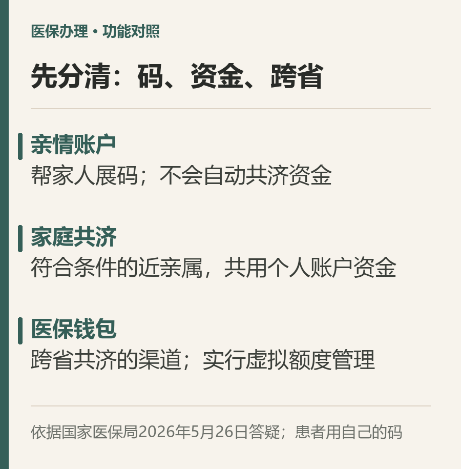
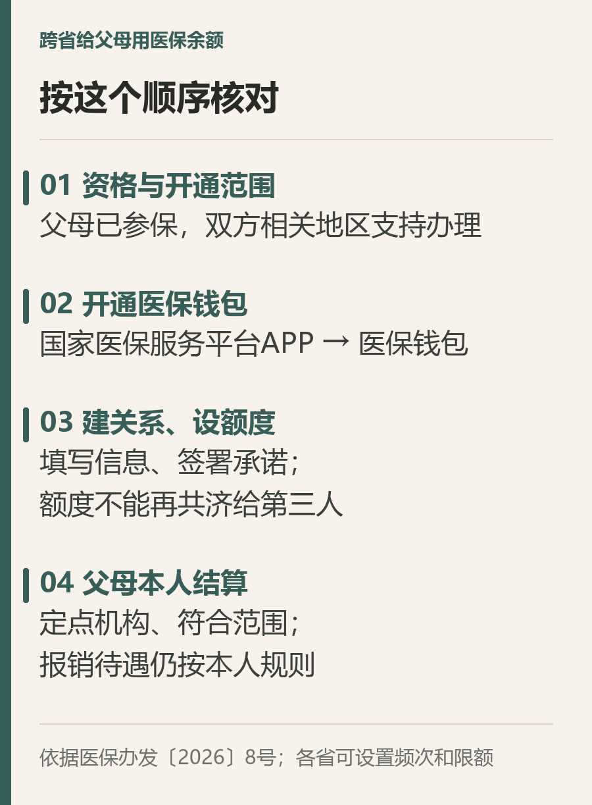

# 给外省父母用医保余额，别只绑亲情账户

你在外地参加职工医保，个人账户里还有余额。父母在老家看病，想让他们用上这笔钱，第一步究竟该绑定什么？

先记住一个区别：**亲情账户帮家人出示医保码；家庭共济才涉及个人账户资金。跨省共济，要关注医保钱包。**

国家医保局今年5月的官方答疑已经把三者区分开来。6月公布的《职工基本医疗保险个人账户跨省共济经办规程（试行）》，进一步明确了共济对象、额度和使用规则。[官方答疑](https://www.nhsa.gov.cn/art/2026/5/26/art_14_20723.html) · [经办规程，医保办发〔2026〕8号](https://www.nhsa.gov.cn/art/2026/6/5/art_104_20858.html)

## 先看这件事是否适合你

出钱的一方，应当是职工基本医疗保险参保人，有可供共济的个人账户资金；接受共济的父母，也需要参加基本医保，职工医保或城乡居民医保均在范围内。

共济对象限近亲属，包括配偶、父母、子女、兄弟姐妹、祖父母、外祖父母、孙子女、外孙子女。公公婆婆、岳父岳母不在你本人的这份近亲属范围内，不能按“都是一家人”直接绑定。

例如，你可以按规定给自己的母亲设定共济额度；给配偶的母亲办理，则要换成符合亲属关系的共济人。没有参保的家属，也不能仅靠绑定关系获得医保报销待遇。

另外，医保钱包服务是否已经在双方相关地区开通，需要先确认。国家医保局5月答疑仍说明覆盖范围在持续扩展，不能把全国统一规则理解成每个地方都已能马上办理。

## 办理时按这个顺序核对

**第一步，查看医保钱包入口。**登录“国家医保服务平台”APP，在首页进入“医保钱包”。官方说明，进入后会显示待开通信息，确认使用后开通。找不到入口或系统提示地区不支持时，先向参保地医保经办机构核实开通情况。

**第二步，建立共济关系。**按页面要求填写父母的信息、确认亲属关系，并由共济人签署承诺书。规程允许通过国家医保服务平台APP、省级医保服务平台或参保地医保经办机构窗口办理；不同渠道的页面名称可能有差异。

**第三步，给被共济人设定额度。**医保钱包实行虚拟额度管理。设定后，这一部分个人账户资金你自己不能再使用，父母也不能把获得的额度继续共济给第三人。额度、转出频次等限制，各省可结合实际设置，别套用网上流传的统一金额。

**第四步，就医购药时使用父母自己的医保码或卡。**支付时能否使用钱包、费用是否符合范围，要由相应定点机构和结算系统确认。提前向拟就医的医院、药店问清楚，比到了收费窗口才试更稳妥。

## 钱能帮忙，报销待遇不能借

共济不会让参加居民医保的父母，变成享受你职工医保报销比例的参保人。他们看病仍按自己的参保身份和相应规则结算，共济资金用于支付符合规定的个人负担费用。

规程明确，定点医疗机构就医的个人负担医疗费用，以及定点零售药店购买符合规定的药品、医疗器械、医用耗材发生的个人负担费用，可以按规定使用共济额度。给父母买药，也不能理解成药店里任何商品都能支付。

用于缴纳城乡居民基本医保、长期护理保险个人缴费部分时，规程要求全额支付。准备使用前，应确认当地缴费渠道是否支持，以及可用额度是否足够。[规程原文，第十一至十七条](https://www.nhsa.gov.cn/module/download/downfile.jsp?classid=0&filename=9729249ba0ac4a34a70ed9f1485a762d.txt)

已经绑定亲情账户，也不必解绑重来。它仍能帮助你代父母展码，只是不会自动完成资金共济。

今天可以先做两件事：在自己的APP里查看钱包是否可开通，再请父母确认参保状态和常去的定点机构。办理的目的，是把个人账户的钱用到家人需要的地方；挂号结算时，始终认准患者自己的身份。
