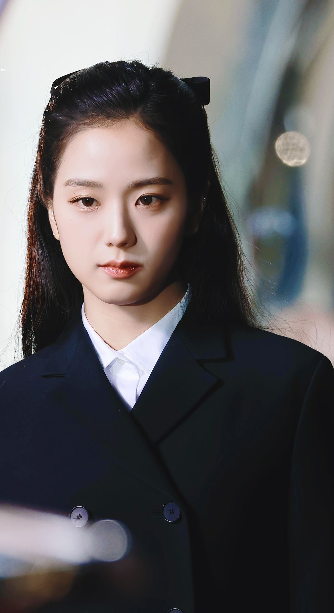
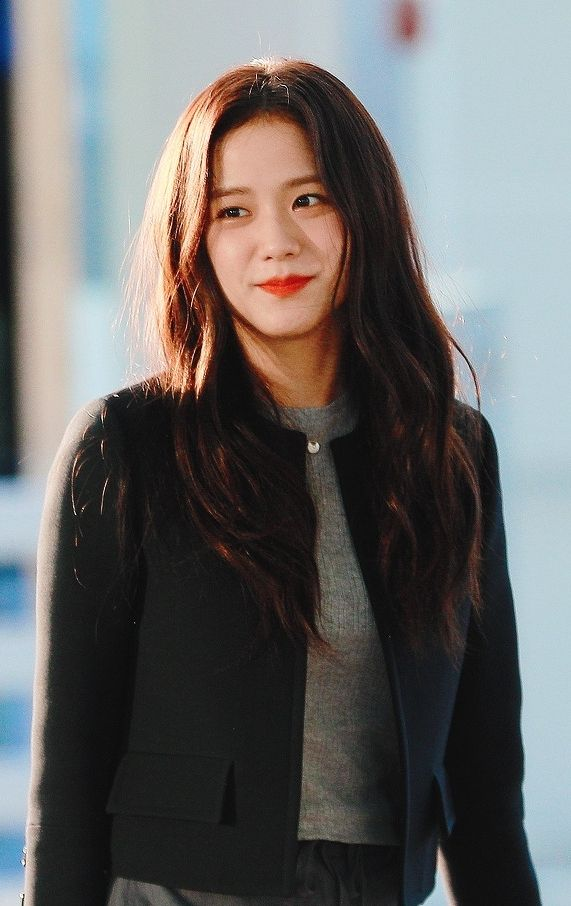
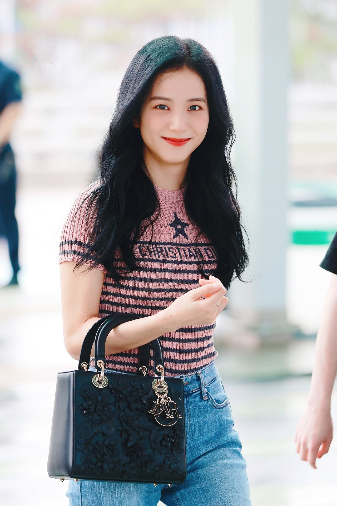
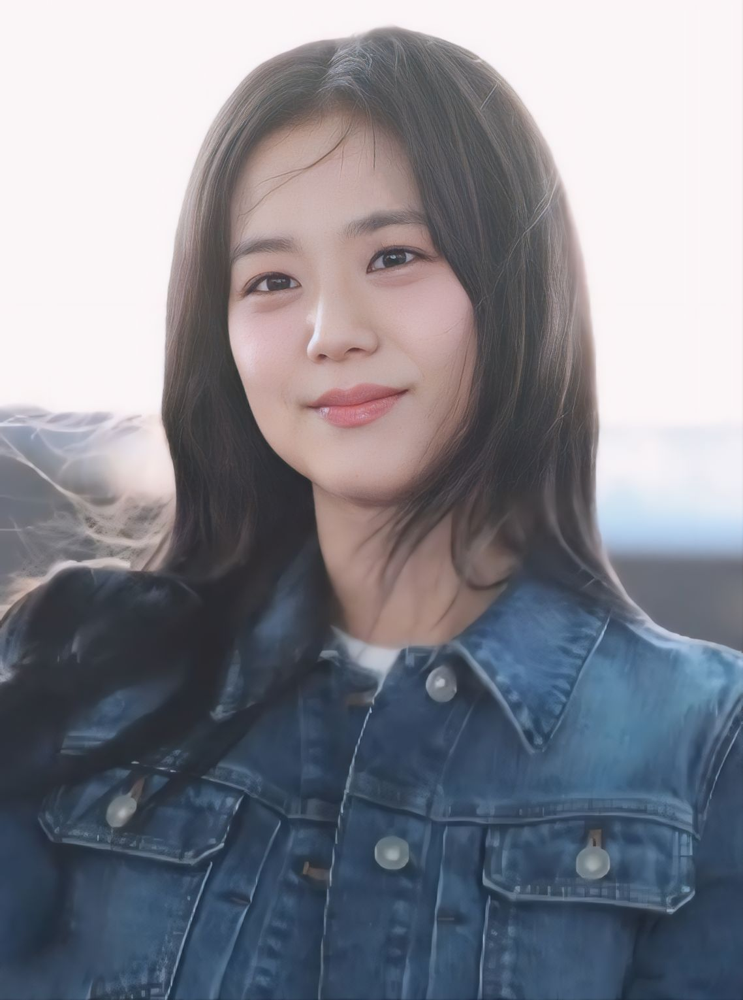
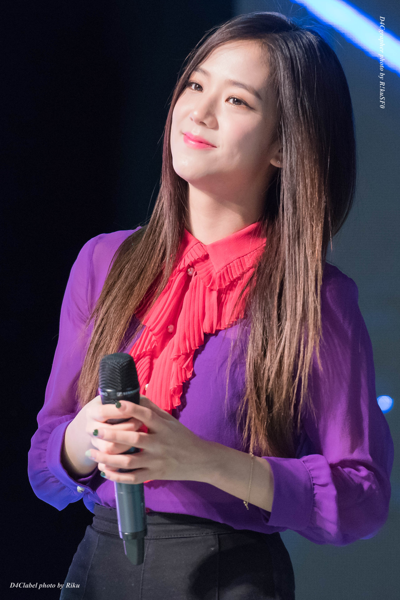

# Jisoo五张旧照：领口比“同款”更值得抄

看明星穿搭，最容易先问衣服是什么牌子。但把视线从标签挪到脸周围，往往能找到更容易复刻的东西：领口留了多少空间，外套怎么叠，颜色在哪里收住。

今天回看Jisoo（金智秀）五张公开旧照，包含2017年舞台、2022年活动、2023年出行和2024年机场造型，并非今天的新图。照片大多是上半身，我们就只讲画面里能看清的搭配，不替镜头外的裤型和鞋子下结论。

## 黑西装配白衬衫，先看脸周围的黑白分界

这张2022年的活动照里，白衬衫的尖领露在黑色西装上方。白色靠近面部，黑色翻领向下展开，上半身有了清楚的层次。

值得抄的是这个分界。穿黑西装总觉得脸周围太沉，可以先试着露出一截干净的浅色领口，再决定需不需要项链。

同时看肩部：外套翻领比较宽，肩线也有存在感。平时不想让上半身显得更宽，不必原样照搬；试窄一些的翻领、自然肩线，把黑白对比留下就够了。发饰和衣服都在表达风格，通勤时也可以减掉其中一项。

摄影：[Off the page](https://commons.wikimedia.org/wiki/File:Kim_ji-soo.jpg)，[CC BY 4.0](https://creativecommons.org/licenses/by/4.0/)。

## 黑外套叠灰色内搭，层次可以来自中间那一块

这张2023年的旧照里，外层是黑色圆领外套，里面露出灰色上衣。与上一张尖领衬衫不同，这套的领口线条更平缓，外套两侧的黑色又把灰色围在中间。

它没有依赖三四种颜色来制造层次，灰色内搭的存在就足够让人看清“里外两层”。外套靠近领口的亮色扣子，则提供了一个小的视觉停顿。

普通人穿黑色开衫、短外套时，可以先换一件灰色内搭看看。若觉得脖子周围太挤，再调整内搭领口的高度；不必为了学这套，一起买复杂的首饰。

摄影：[Off the page](https://commons.wikimedia.org/wiki/File:Kim_Jisoo_on_July_3,_2023_09.jpg)，[CC BY 4.0](https://creativecommons.org/licenses/by/4.0/)。

## 条纹、字母、挂饰都出现时，照搬要学会减一项

粉色短袖针织上有横条纹，也有星形、字母图案；黑色包袋体积明显，包上的装饰又增加了一层细节。这套出行造型好看的地方，是休闲衣服与有轮廓感的包形成了对照。

但要复刻，最不必做的就是把所有元素一件件找齐。

如果衣柜里已经有图案针织，就搭一个表面简单的包；如果喜欢挂饰包，则可以把上衣换成纯色或单纯条纹。让其中一件负责热闹，另一件负责安静，比同时追求近似同款更容易协调。

照片还能看到针织与牛仔裤腰口的衔接。试穿时把下摆收整齐，再放下手臂看看包有没有遮住自己想保留的腰口，比单看衣服平铺更有参考价值。

摄影：[Off the page](https://commons.wikimedia.org/wiki/File:Kim_Jisoo_in_July_2023_04.jpg)，[CC BY 4.0](https://creativecommons.org/licenses/by/4.0/)。

## 牛仔外套的利落，藏在衣领和明线里

这张2024年2月的机场照，牛仔外套的尖领、明线、金属扣和胸前翻盖口袋都很清楚。牛仔布本身偏休闲，这些有秩序的线条又让上半身没有显得松散。

选同类外套，除了看颜色，还可以看领子是否容易塌、门襟是否平整、口袋的位置是不是你喜欢的。

胸前并排的口袋，会强化这一带的横向线条。希望上半身更简洁，可以找口袋更低调、胸前细节更少的款式。里面再叠有厚领子的衣服时，也要试穿确认领口会不会堆在一起。

这一张给我们的主要信息，是上半身的结构感。工作日需要利落一点，就从领子和门襟是否平整开始检查，不必把牛仔外套一概归成周末才能穿的衣服。

影像作者：[K-POPIT 케이팝잇](https://commons.wikimedia.org/wiki/File:20240226_Kim_Jisoo_김지수_02.jpg)，[CC BY 3.0](https://creativecommons.org/licenses/by/3.0/)。

## 紫色和粉色很醒目，日常穿可以只留一个主角

最后这张来自2017年的舞台造型：紫色外层、粉红色荷叶边内搭，色彩与领口的褶边一起把注意力集中到上半身。舞台灯光和演出场景，也参与了我们看到的效果。

喜欢这种明亮感，日常却不一定需要两种醒目的颜色同时靠近脸。

可以保留紫色外套，里面换成干净的浅色；也可以保留粉色荷叶领，把外套换成色彩更安静、线条简单的款式。荷叶边已经提供了足够的细节，耳饰便可以小一点。

舞台穿搭可以借鉴它的颜色关系，不必照搬它的表达强度。选一处让自己喜欢的颜色出现，往往比把整套复刻下来更好穿。

摄影：[D4cgrapher](https://commons.wikimedia.org/wiki/File:170517_Kim_Ji-soo_Blackpink_01.jpg)，[CC BY-SA 4.0](https://creativecommons.org/licenses/by-sa/4.0/)，保留原图作者标记。

这五张照片里，最适合带回衣柜的，也许不是一件新衣服。先把现有外套和内搭放在一起，看一眼领口、肩部与颜色：留下一个重点，其余地方稍微安静一点。
