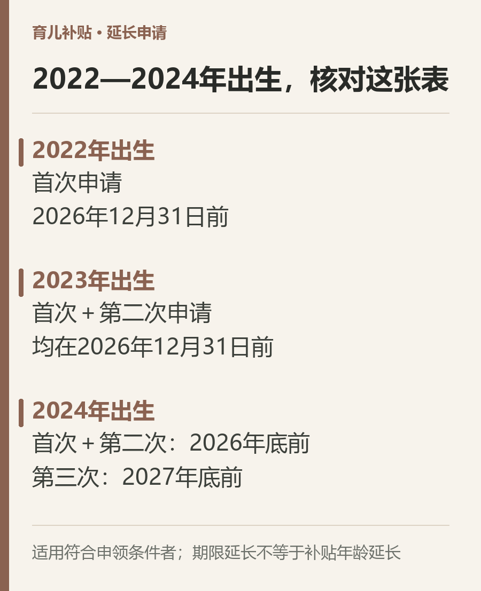
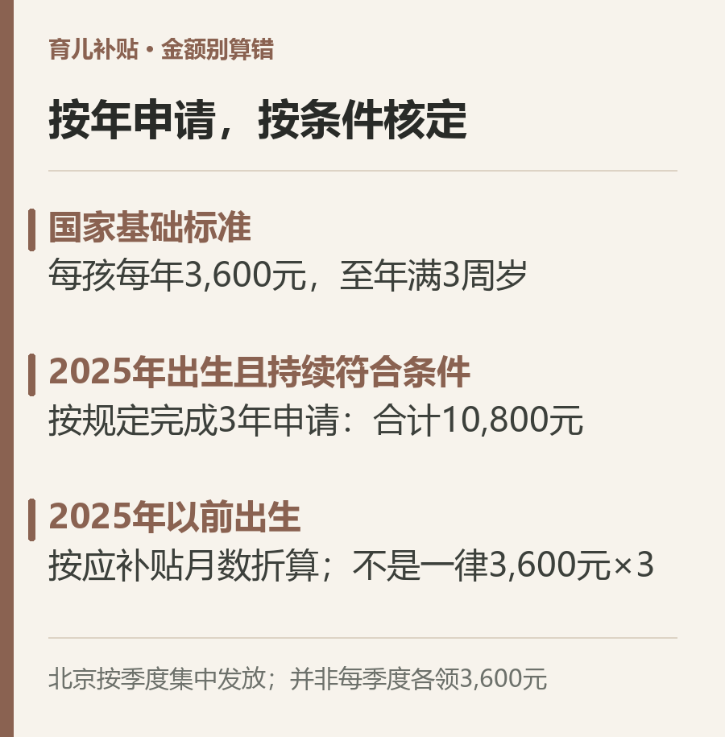

# 北京育儿补贴漏领了？今年还有补申请通道

孩子是2023年或2024年出生的，去年没有申请育儿补贴，今年再看消息，却发现旧通知里写着“2025年12月31日前申请”。是不是已经错过了？

先别按旧截止日期放弃。**今年7月，2022—2024年出生婴幼儿首次育儿补贴申请的截止时间，已经延长到2026年12月31日。**符合条件、此前漏申领的家庭，可以通过延长申请通道办理。[首都之窗公布的政策解答，2026年7月21日](https://www.beijing.gov.cn/ywdt/zybwdt/202607/t20260721_4775202.html)

这篇面向按北京渠道申领的家庭，把“补首次申请”和“今年续领”分开说清楚。信息核查截至2026年10月13日。

## 先看孩子户籍，再看出生年份

北京实施细则以符合规定的北京市户籍婴幼儿为对象。仅仅父母在北京上班、缴纳社保，不能据此认定孩子就能在北京申领；外地户籍孩子，应按其户籍地渠道核实办理。

申领人通常为父母中的一方，特殊情况由符合要求的其他监护人办理。需要填写孩子及申领人信息，提供出生医学证明、居民户口簿等基础材料，必要时补充抚养关系的法定有效材料。户籍、监护人等信息有变化，要提交申请时的现状材料。[北京市实施细则](https://wjw.beijing.gov.cn/zwgk_20040/zcwj2024/202511/t20251125_4304288.html)

再按出生年份，检查要完成哪一次申请：

| 孩子出生年份 | 延期政策下需要核对的申请 |
| --- | --- |
| 2022年 | 符合条件且漏申领的，首次申请最晚2026年12月31日提交 |
| 2023年 | 首次申请和第二次申请（续领），均最晚2026年12月31日提交 |
| 2024年 | 首次和第二次申请均最晚2026年12月31日；第三次申请最晚2027年12月31日 |

这里的年份表回答的是“什么时间交哪次申请”，不是说每个孩子现在都能领一整年的3,600元。尤其是2022年出生的孩子，延长的是符合条件时段的首次申请机会，不是将补贴年龄延长到4岁。

## 每年3,600元，不等于每次申请都领3,600元

国家基础标准为每孩每年3,600元，发放至年满3周岁。2022—2024年出生的婴幼儿，按应补贴月数折算金额。

可以用一个边界清楚的例子理解：2025年出生、符合北京申领条件并按规定完成各年申请的孩子，可连续申领3年，合计10,800元。这个合计分年度申请、发放，并不是提交一次申请就马上到账10,800元。[北京市领取办法说明](https://www.beijing.gov.cn/fuwu/bmfw/bmjy/202511/t20251127_4307626.html)

如果孩子在2025年之前出生，不能把3,600元简单乘三。应补贴月数、出生时间以及既往申领情况，会影响实际核定金额。

今年的延期，没有改变原有补贴标准。对漏申领家庭最重要的变化，是重新获得了提交相应申请的时间窗口。

## 漏申请的，找这个入口；去年领过的，检查续领

**去年没有及时首次申请，孩子又在2022—2024年出生：**可在微信或支付宝搜索“育儿补贴”小程序，登录育儿补贴信息管理系统，在“我的”页面点击“2022—2024年延长申请通道”。按所需年度提交材料，并查看相应申请状态。北京市政务服务平台也提供申领渠道。

**去年已经领过，今年还在可申领范围内：**进入申领系统检查2026年度续领，不要把去年的审核通过，当成今年自动办完。北京年初通知明确，2023年、2024年出生且符合条件的孩子，可以按规定办理今年续领；材料没有变化时确认提交，有变化时先更新。[北京2026年度申领提示](https://www.beijing.gov.cn/fuwu/bmfw/sy/jrts/202601/t20260112_4423508.html)

2023年、2024年出生且首次、第二次申请都尚未完成的，尤其要检查两次申请是否分别提交，不能只看到一条申请成功，就认为全部年度都办好了。

线上操作困难，可以到孩子户籍所在地乡镇政府、街道办事处现场办理。

## 提交成功后，再看审核和发放

北京按季度集中发放补贴，但补贴仍按年度申请，并不是每季度各领3,600元。提交、审核通过、资金到账是不同状态，12月31日这个日期也不能理解成保证到账日。

现在打开系统，先核对孩子名下有哪些年度申请、各处于什么状态。缺的是首次申请，就找延长通道；缺的是续领，就补对应年度。把这两件事分清，比反复收藏旧通知更有用。
