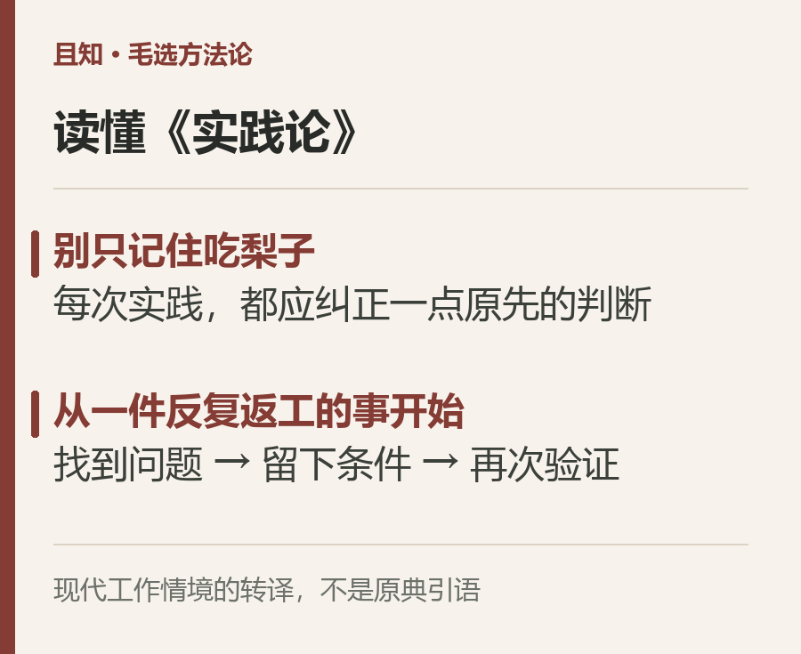
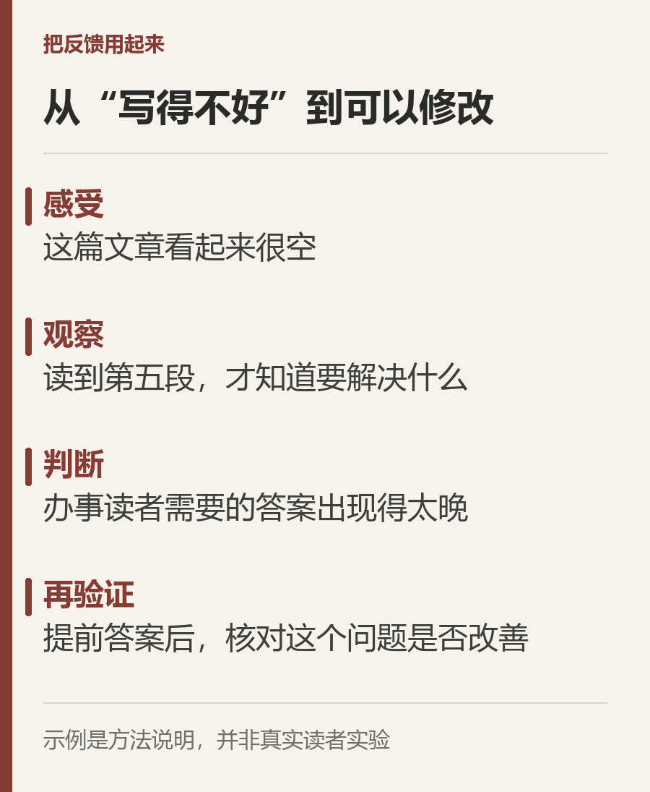
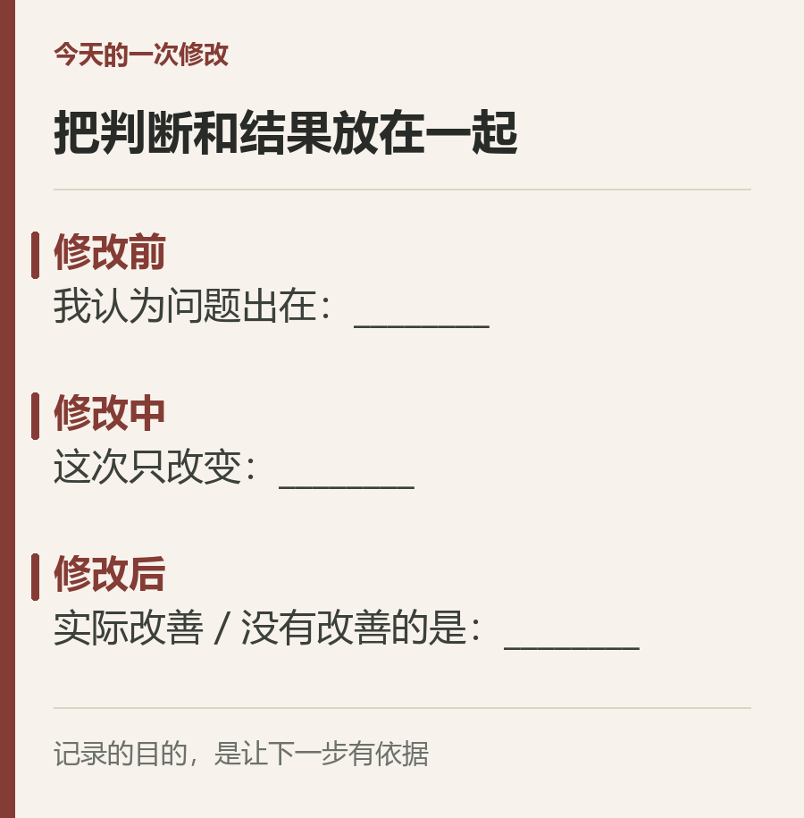

# 毛选：读懂《实践论》，别只记住吃梨子

一项工作交出去，收到的仍是“还不够好”。你补了资料，改了标题，又找来一套方法，下一版却还是没有抓住问题。

最难受的地方在于：你没有偷懒，甚至比以前做得更多，却说不清自己到底把哪件事弄明白了。

读《实践论》，可以先放下“知道了就赶紧行动”的催促，问一个更细的问题：**这次行动，能不能让你发现原先的判断错在哪里？**

## 一、吃过梨子，也不等于认识了所有梨子

《实践论》写于1937年，收入《毛泽东选集》第一卷。文中用吃梨子的比喻说明认识与实践的关系，但紧接着也讨论了间接经验：人不可能事事亲历，学习他人的知识，本来就是认识世界的重要途径。[《实践论》全文](https://news.12371.cn/2017/08/29/ARTI1504001411770206.shtml)

如果只把这篇文章读成“少看书，多动手”，就漏掉了后面的功夫。

亲身接触事物，能得到具体的感觉和经验；从这些材料中找出联系，形成判断，再回到实际中检验，才是一个继续深入的过程。忙过一次、失败一次、碰巧成功一次，都不会自动完成这个过程。

不妨只看一件事：把一篇文章改到读者愿意看下去。

第一版写得很认真，编辑却说开头空。你读了几篇写作教程，知道开头要抓人，于是加了一句更有冲击力的话。第二版还是被退回。

这里真正缺少的，也许不是更厉害的开头技巧，而是你还没有弄清：读者打开文章时，究竟在等一个什么答案。

## 二、把“写得不好”拆成一个能核对的判断

“我表达能力差”太大了。它容易让人沮丧，却很难指向下一次修改。

换一个小一点的判断：开头用了四段背景，读者到第五段才知道这篇文章要解决什么问题。这样的判断，可以拿正文核对，也可以拿修改后的版本比较。

假如文章回答的是“去年领过的补贴，今年还要不要再申请”，开头却从家庭支出谈到政策意义，读者最着急的事始终悬着。把办理答案提前，比再添一句漂亮话更有用。

这是一个说明方法的假设情境，不是一项真实读者实验。它提醒我们：反馈必须落到可观察的地方。“不行”只是感受，“答案出现得太晚”才开始接近问题。

**能让下一步发生变化的反馈，才真正进入了认识。**

## 三、别把一次结果急着写成规律

把答案提前以后，文章得到认可，就能认定“所有文章都应该第一句给答案”吗？还不能。

办事指南与人物故事，读者的期待不同。读者急着找入口，答案应当容易找到；读者愿意跟着人物经历往下走，过早揭底也可能损害叙述。一次修改有效，说明的是这个问题在这些条件下得到了改善。

这就是整理经验时最容易省掉的一步：留下条件。

如果只记“这次改短了就好了”，下一次便可能不分青红皂白地删。如果记的是“这篇指南的读者需要马上确认资格，所以删掉无关背景，把适用条件放到前面”，经验才保留了可迁移的部分。

读《实践论》的价值，也在这里：从具体接触走向判断，再让判断接受新的检验。既不能把书本结论直接套上去，也不能把个人的一次经历当成普遍真理。

## 四、今天只改一个有依据的地方

如果你手上也有一件反复返工的事，先别急着把自己全部推翻。

拿出最近一次反馈，找出对方明确指出的位置。写下你认为导致问题的原因，再做一次范围清楚的修改。修改之后，比较的是那个具体问题有没有改善，而不是自己有没有更努力。

如果结果仍然不好，就回来检查原因判断；如果结果变好了，就把适用条件一起留下。

书可以继续读，事也要继续做。但每做一次，都应该比上一次更清楚一点：自己原先相信什么，现实又纠正了什么。

你最近一次返工，是修改了作品，还是也修改了对问题的判断？
