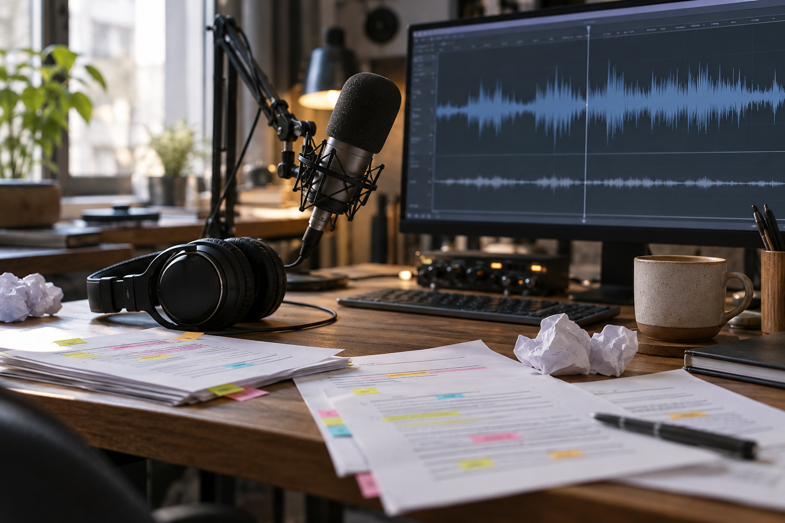
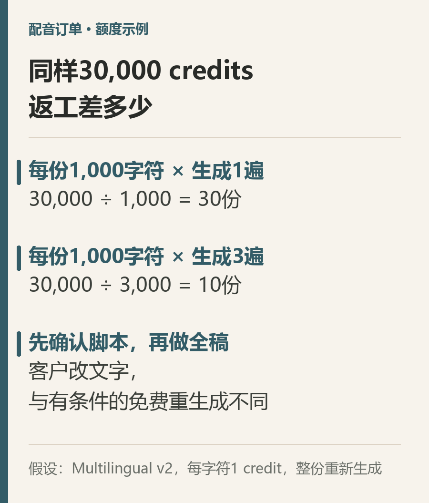

# 一家AI公司月费6美元，客户改稿谁买单

给客户做一段配音，第一次生成只花了一小会儿。真正拖住交付的，可能是后面的几句话：语气再轻一点，品牌名换个读法，开头再改两句。

工具的订阅费写在价格表上，客户的修改次数却不会提前写好。

今天看ElevenLabs，我更关心一个具体问题：一个人接配音订单，怎样把“生成成功”变成“交付得出去”，又不让返工把预算吃掉。

## 先把月费看准，再算一条音频

截至2026年10月13日，ElevenLabs官网月付页面显示，Starter常规价格为每月6美元，包含每月30,000 credits。页面同时有截至10月18日的首月1美元促销。首月优惠与后续订阅价格，应当分开计算。[官网价格页](https://elevenlabs.io/pricing)

30,000 credits也不能直接读成“能接多少单”。同一段文字，采用什么模型、生成多少遍，都会影响消耗。

官网说明，Multilingual v2按每个字符1 credit计算；其他模型的费率可能不同。下面只按这一口径做一个预算例子：假设每份定稿脚本为1,000字符，而且这个月的额度全部用于这项配音任务。

如果每份只完整生成一次，30,000÷1,000，理论上对应30份。若每份因为改稿而完整生成三次，30,000÷3,000，就只剩10份。

这不是实际接单记录，也不是利润测算。它说明的是同一份月度额度，可能被返工消耗掉多少。剪辑、沟通、音乐授权、税费和其他工具支出，都还没有算进去。

## 免费重生成，有条件，也有范围

ElevenLabs并不是每点一次重生成都必然扣费。

帮助中心列出了网站部分场景的免费重生成条件。例如，在符合要求的Speech Synthesis场景中，文字、声音、模型等关键条件保持不变，可以获得有限次数的免费重生成；时间和页面状态也有限制。Studio另有相应规则。

但客户把文字改了，就不能据此假定仍然免费。官方同时明确：API没有免费重生成机制。[生成与额度规则](https://help.elevenlabs.io/hc/en-us/articles/13313274666769-Do-I-use-quota-on-every-generation)

所以，“做一条音频成本很低”和“这个订单的修改成本很低”，是两笔需要分别核对的账。前者取决于单次生成，后者还取决于客户什么时候确认脚本、怎样提出修改，以及你是否把整条音频重新做了一遍。

## 第一笔订单，先确认文字，再生成全稿

假设客户需要一段产品介绍配音。更稳妥的交付顺序，是先让客户确认文字内容，尤其是品牌名、数字、外语词和必须准确表达的条款。

随后选一小段有代表性的内容，确认声音、语速和大致情绪。样段不能证明长稿的每句话都合格，但可以让双方先发现明显的风格分歧。

全稿完成后，按句检查发音、停顿和前后音量。哪些地方是你没有做到已经约定的要求，哪些是客户改变了原先确认的内容，最好在交付约定中提前区分。修改轮次和新增文字怎样计费，也应该在报价时说清楚。

这些步骤增加了前期沟通，却能让后面的返工有边界。客户买的是可使用的成品，订阅工具只是你完成交付的一项投入。

## 商用资格也要在生成前确认

另一个容易被忽略的时间点，是音频生成时所处的订阅状态。

官方说明，免费计划生成的内容不具备商业许可；后来升级付费，不能自动给此前免费生成的内容补上商业使用权。付费期间生成、符合条件的内容，可以依许可用于商业用途；Beta服务另有限制，声音和输入材料的权利仍需自行确认。[内容发布与商业使用说明](https://help.elevenlabs.io/hc/en-us/articles/13313564601361-Can-I-publish-the-content-I-generate-on-the-platform)

如果准备收费交付，先确认账户、模型与素材的许可，再生成正式版本，比交稿前补救省事得多。

本文依据官网定价与帮助文档进行资料分析，没有进行真实客户接单测试。对于一个人的业务，今天可以先做的事很小：把下一份配音报价里的“包含几轮修改、怎样算新增需求”，写成客户看得懂的两句话。
